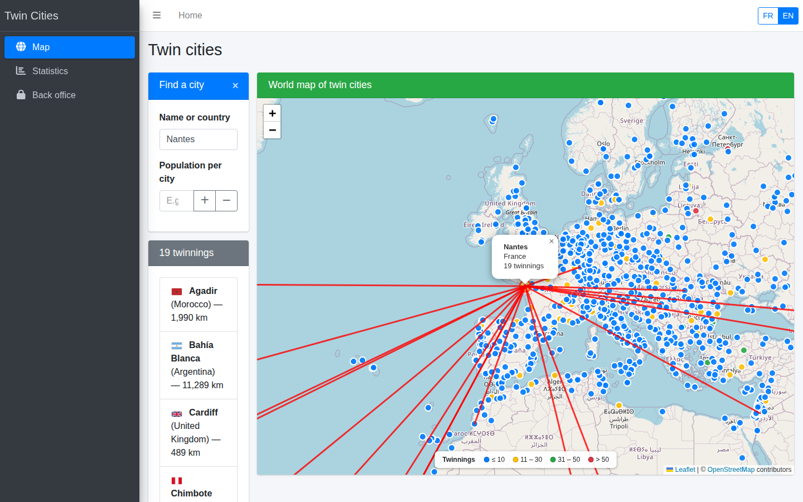
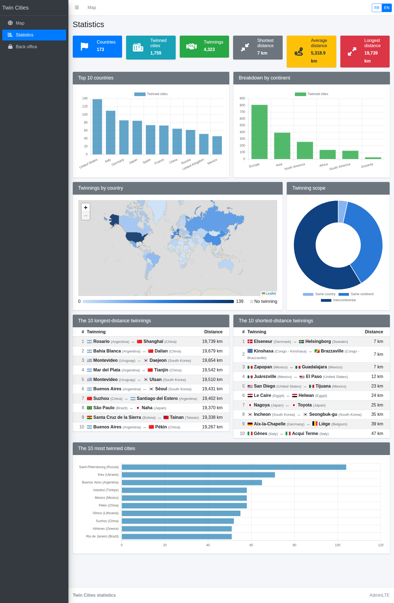
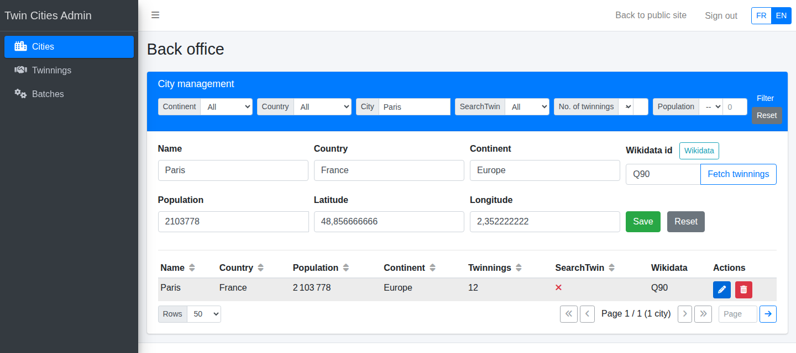
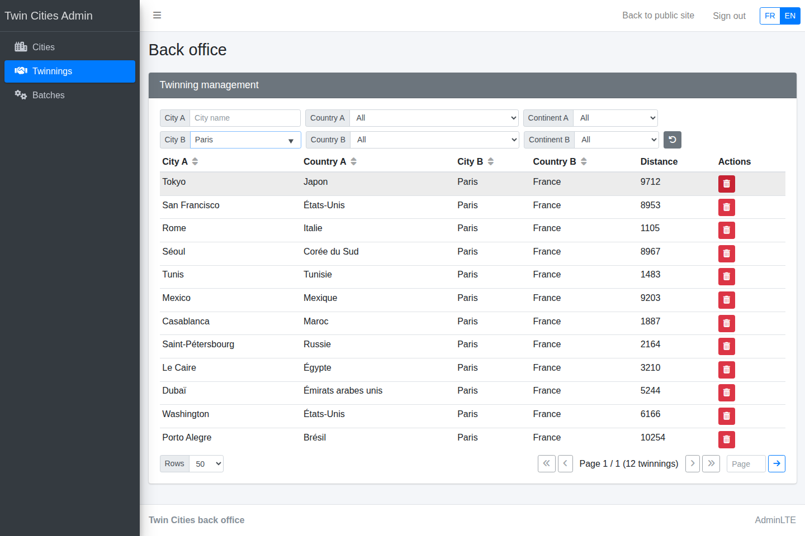

# Twin Cities Dashboard

A small Flask web app to explore twin cities (sister cities) on an interactive world map, with statistics and a back office to manage the data.

The bundled database contains about 1,760 cities and 4,300 twinning links, enriched from Wikidata.



## Features

- **World map**: every city is plotted on a Leaflet map and coloured by its number of twinnings. Click a city to draw its links and list its twin cities.
- **Search** by city or country name, with an optional population filter.
- **Statistics**: top countries, breakdown by continent, distances and a choropleth map of twinnings by country.
- **Bilingual interface**: the whole site, back office included, is available in French and English. Use the FR / EN switch in the top-right corner. The language is detected from the browser on the first visit.
- **Back office** (login required):
  - manage cities and twinning links;
  - import twin cities and population figures from Wikidata;
  - run predefined data-cleaning batches.

## Screenshots

### Statistics

Key figures, top 10 countries, breakdown by continent, a choropleth map of twinnings by country, the scope of twinnings (same country, same continent, intercontinental), the 10 longest and shortest twinnings, and the 10 most twinned cities.



### Back office: cities

Filter the city list and edit a city. Here, Paris is loaded in the form, with its Wikidata id and population.



### Back office: twinnings

All twinning links with Paris as city B. Each link can be removed with the red delete button.



> Data such as country and continent names is stored in French and shown as-is in the back office, so that it can be edited.

## Requirements

- Python 3.10 or later
- Internet access in the browser: map tiles, flags and front-end libraries are loaded from public CDNs.

## Installation

```bash
git clone <repository-url>
cd TWINCITIES
python3 -m venv .venv
source .venv/bin/activate          # Windows: .venv\Scripts\activate
pip install -r requirements.txt
```

### Set the admin password

Configuration is read from a `.env` file next to `app.py`. This file is ignored by git, so each installation has its own credentials.

```bash
cp .env.example .env
```

Then edit `.env`:

```ini
ADMIN_USER=admin
ADMIN_PASSWORD=choose-a-strong-password
FLASK_SECRET=paste-a-random-string-here
```

To generate a value for `FLASK_SECRET`:

```bash
python -c "import secrets; print(secrets.token_hex(32))"
```

> There is no default password. While `ADMIN_PASSWORD` is empty, the public site works normally, but the back office cannot be accessed and a warning is printed at startup.

### Run

```bash
python app.py
```

Open <http://127.0.0.1:5000>. The back office is at <http://127.0.0.1:5000/admin>.

## Configuration

Each variable can be set in `.env` or directly in the environment. Values from the environment take precedence.

| Variable | Purpose | Default |
|---|---|---|
| `ADMIN_USER` | Back-office username | `admin` |
| `ADMIN_PASSWORD` | Back-office password | *(none: back office disabled)* |
| `FLASK_SECRET` | Key used to sign session cookies | random at each start (sessions are lost on restart) |
| `FLASK_DEBUG` | `1` enables debug mode and auto-reload | `0` |
| `FLASK_HOST` | Listening address | `127.0.0.1` |
| `FLASK_PORT` | Listening port | `5000` |

> Never enable `FLASK_DEBUG=1` on a server reachable from a network. The Werkzeug debugger allows code execution.

Without debug mode, Flask does not reload code or templates automatically, so restart the server after changing them.

## Database

`twin_cities.db` is a SQLite database shipped with the repository. It is ready to use and contains three tables:

| Table | Content |
|---|---|
| `Villes` | Cities: name, country and continent (in French), population, coordinates, Wikidata id |
| `TwinCities` | Twinning links between two cities, with the distance in km |
| `Batchs` | Predefined SQL batches available in the back office |

Country and continent names are stored in French. The English interface translates them when displaying them.

`init_db.py` is only needed to start from an empty database. It creates the tables and a handful of sample cities:

```bash
rm twin_cities.db      # only if you really want to start over
python init_db.py
```

## Project structure

```
app.py               Flask application: routes, API, security, i18n helpers
translations.py      Interface texts (French / English)
init_db.py           Creates an empty database with sample data
twin_cities.db       SQLite database (published with the project)
templates/           Jinja templates (public pages, back office, 404)
static/js/           Front-end scripts (map, statistics, back office, i18n)
static/flags/        Cached country flags (downloaded from flagcdn.com)
.env.example         Configuration template
```

## Adding a language

1. Add the language to `LANGUAGES` in `translations.py`.
2. Copy the `"en"` block of `TRANSLATIONS` under the new language code and translate the values.

The language switch picks the new language up automatically.

## Security notes

- **Back-office access**: the back office requires a login. Passwords are compared in constant time.
- **CSRF**: every write request (`POST`, `PUT`, `DELETE`) must carry a per-session token.
- **Escaping**: user and Wikidata content is escaped before being inserted into the page.
- **Production**: `python app.py` runs Flask's development server. For a public deployment, use a WSGI server instead (for example `gunicorn app:app`) behind HTTPS.

## Data sources and credits

- Twinning data, populations and coordinates: [Wikidata](https://www.wikidata.org/) (CC0)
- Map tiles: © [OpenStreetMap](https://www.openstreetmap.org/copyright) contributors
- Country shapes: [Natural Earth](https://www.naturalearthdata.com/) (public domain)
- Flags: [flagcdn.com](https://flagcdn.com/)
- UI: [AdminLTE](https://adminlte.io/), [Leaflet](https://leafletjs.com/), [Chart.js](https://www.chartjs.org/), [Font Awesome](https://fontawesome.com/)

## License

The code is released under the [MIT License](LICENSE).

The bundled data keeps the licence of its sources. Wikidata content is CC0. Map tiles and flags are subject to the terms of their respective providers.
